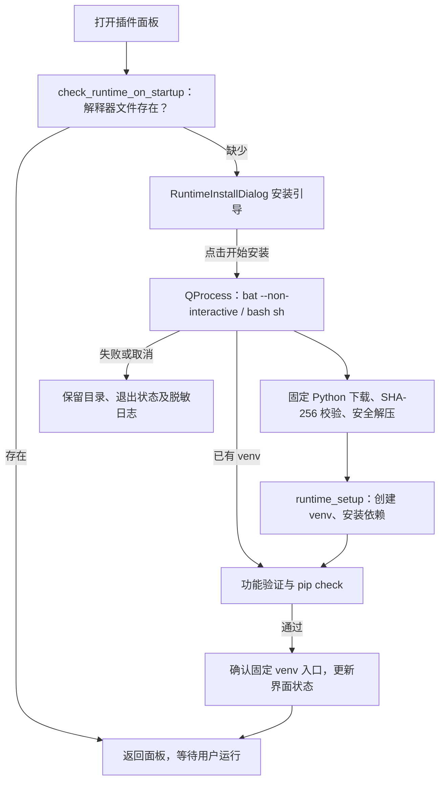

# 开发入口与本地代码理解

本文按当前主线提交 `211975d7`（2026-09-11）核对。reflog 中的 `b92a1f67`（PyTorch wheel 改用阿里镜像）已被舍弃，不属于当前实现；开发文档、本地记忆和代码索引均不得继续把该提交的固定阿里镜像、递归补 wheel 或废弃旧 `SAM_TORCH_*` 变量等行为当作现行约定。完整安装参数、固定资产和平台边界见 [install.md](install.md)，模型契约见 [model_layout.md](model_layout.md)。协作约定以 [AGENTS.md](../AGENTS.md) 和 [CLAUDE.md](../CLAUDE.md) 为准，两者正文同步维护。

## 源码导航

| 关注点 | 入口与职责 |
| --- | --- |
| 打开插件 | [land_cover_classification.py](../land_cover_classification/land_cover_classification.py) 的 `LandCoverClassification.run()` 展示面板后调用启动检查 |
| 安装界面 | [land_cover_classification_dialog.py](../land_cover_classification/land_cover_classification_dialog.py) 的 `check_runtime_on_startup()`、`_show_runtime_installer()`、`RuntimeInstallDialog` |
| 下载与引导 | [create_sam_venv.bat](../land_cover_classification/vendor/sam_runtime/create_sam_venv.bat) 内联 PowerShell；[create_sam_venv.sh](../land_cover_classification/vendor/sam_runtime/create_sam_venv.sh) 通过 Bash 执行 |
| 公共安装实现 | [runtime_setup.py](../land_cover_classification/vendor/sam_runtime/runtime_setup.py) 的 `clean_environment()`、`install_dependencies()`、`verify_environment()`、`publish_link()` |
| 依赖检查与子进程环境 | [pytorch_deps_check.py](../land_cover_classification/pytorch_deps_check.py)、[sam_deps_check.py](../land_cover_classification/sam_deps_check.py) |
| 生产推理 | [pytorch_inference_runner.py](../land_cover_classification/pytorch_inference_runner.py) → [pytorch_inference_core.py](../land_cover_classification/pytorch_inference_core.py) 的 `run_inference()` → [pytorch_streaming.py](../land_cover_classification/pytorch_streaming.py) |
| 草稿与导出 | [draft_session.py](../land_cover_classification/draft_session.py)、[ai_edit_controller.py](../land_cover_classification/ai_edit_controller.py)、[export_service.py](../land_cover_classification/export_service.py) |

## 安装调用关系



存在性检查只判断解释器文件，不能证明依赖可用。打开面板不导入重依赖；实际安装须由用户点击“开始安装”触发，成功后也不自动运行推理。推理与 AI 按钮缺少环境时提示重新打开插件，功能执行时仍保留各自的依赖和输入验证。

两个入口下载 python-build-standalone CPython 3.12.12 / 20251014，不探测 QGIS 或系统 Python。Windows 使用系统 PowerShell，独立 `create_sam_venv.ps1` 已删除。Windows 固定使用 `%LOCALAPPDATA%\LCCRuntime` 下的 Python/venv，通过目录联接访问插件固定入口；Linux/macOS 支持 `SAM_VENV_DIR`。旧 `SAM_PYTHON` 不生效，`SAM_RECREATE` 不再执行删除。已有完整环境只验证，异常或未完成目录保留并报错。

`clean_environment()` 是安装、PyTorch 与 SAM 子进程的共用边界，清理 Python/GDAL/PROJ/Qt/动态库变量和 QGIS/OSGeo4W 的 PATH 项。QGIS 可导入安装器中的标准库工具函数，重依赖仍只在子进程运行。

当前 Torch 策略以 `runtime_setup.py` 为准：Windows/Linux 默认使用 PyTorch 官方 CPU/CUDA wheel 索引，保留 `SAM_TORCH_CPU_INDEX`、`SAM_TORCH_CUDA_INDEX`、`SAM_TORCH_CUDA_INDEXES` 和 `SAM_TORCH_PACKAGES`；macOS 从官方 PyPI 选择平台 wheel，并按 CPU 验证。通用依赖仍默认使用清华 PyPI 镜像，允许 `PIP_INDEX_URL` 覆盖。不要从已舍弃提交恢复固定阿里镜像下载器或把现有 `SAM_TORCH_*` 来源变量标成废弃。

安装窗口用 UTF-8 增量解码和完整行缓冲显示脱敏日志；取消通过 `LCC_CANCEL_FILE` 通知安装进程。Windows 日志位于 `%LOCALAPPDATA%\LCCRuntime\logs`，Linux/macOS 位于 runtime 的 `logs`；`qgis-install-*.log` 为界面日志，`install-*.log` 为入口日志。

## 拉取后的本地索引与记忆

1. 先用 `git status --short`、`git log` 和 `git reflog` 确认拉取范围与既有改动，不假定每次只有一个提交。
2. 对照实际代码更新开发文档与 AGENTS/CLAUDE。若存在 `.serena/memories/`，同步行为约定、技术栈、命令和验证记忆，不手工修改符号缓存。
3. 在仓库根目录执行以下命令，通过 CodeGraph 自身更新索引，不手改数据库、WAL 或 watcher 状态：

```powershell
codegraph.cmd sync .
codegraph.cmd status .
codegraph.cmd query RuntimeInstallDialog -p .
codegraph.cmd query clean_environment -p .
codegraph.cmd query install_torch -p .
codegraph.cmd query cuda_indexes -p .
```

同步完成后核对状态，并确认符号定位到当前工作树的 `runtime_setup.py`。如果刚执行过 reset、rebase 或舍弃提交，还应使用 `git status --short` 和 `git reflog` 识别残留的未跟踪文件；CodeGraph 会理解当前工作树，不能仅凭提交历史判断索引内容。`.codegraph/` 中除自身 `.gitignore` 外的数据均为本地索引，不能提交。只有文档或索引改动时无需重建运行环境或执行安装下载。


索引范围由仓库根目录 `codegraph.json` 维护，排除测试输出、临时目录和 runtime 的环境/缓存/日志；已舍弃阿里镜像版本残留的未跟踪 `test_torch_aliyun.py` 已删除。`.gitignore` 显式允许 CodeGraph 扫描项目自有 `vendor` 安装脚本。默认排除 `vendor` 会漏掉 `runtime_setup.py`，因此不能仅凭“索引已更新”判断覆盖完整，还需检查 `clean_environment` 的结果是否指向当前公共安装器，避免旧备份混入。

## 复验边界

- 文档：检查相对链接、源码符号、安装参数以及 AGENTS/CLAUDE 正文一致性。
- 安装器：用隔离测试覆盖固定资产校验、归档边界、日志脱敏、取消、安装锁、已有目录保留、Torch 精确约束与 CUDA 回退；测试不得触发真实环境删除或重装。
- 运行环境：用统一 venv Python 执行 `runtime_setup.py --functional-check`，并分别执行 `pytorch_deps_check.py --json` 和 `sam_deps_check.py --backend sam2`。无权重环境验收与外部模型验收分开记录。
- QGIS 集成：手动验证引导、日志、取消、重复打开、安装成功后不自动推理，再验证 runner 与 SAM worker。
- 结果报告：区分本次运行结果、提交附带历史记录和模拟测试；Linux/macOS、CUDA 实机、整机断网重启 QGIS 等未实测项不能由 Windows CPU 或 mock 测试代替。

## 项目管理开发入口

`land_cover_classification/project_panel.py` 负责 QGIS 工作流，`project_client.py` 负责标准库 HTTP 传输与 SQLite 快照；`backend/api.py` 分别构造内外应用，`service.py` 管理 PostGIS 事务与不可变文件，`geometry.py` 校验并生成成果。独立服务环境使用 `.venv-backend/`，不属于推理 runtime。服务从根 `.env` 自动读取配置；插件地址位于 `project_service.ini`，内部免 Key，外部 Key 仅用于查询。文件导出独立于整项目发布。详细部署与测试命令见 [project_service.md](project_service.md)。
